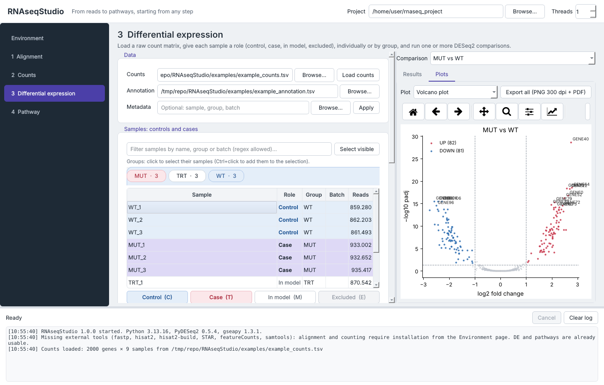
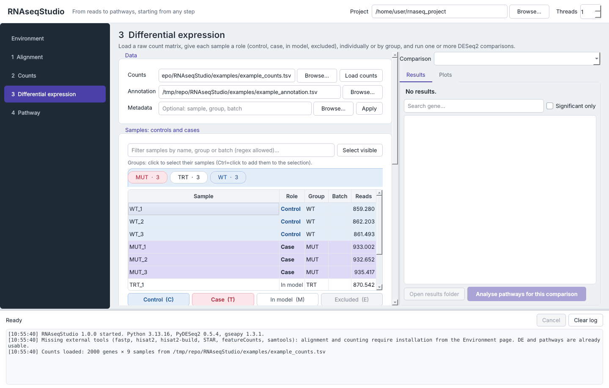

# RNAseqStudio

[](https://doi.org/10.5281/zenodo.23337027)

**From reads to pathways, starting from any step.**
A self-installing desktop application (Python + Qt) for bulk RNA-seq analysis: alignment, gene-level counting, differential expression and pathway analysis — each step usable on its own.



---

## Features

| Step | What it does | Tools |
|---|---|---|
| **1 · Alignment** | Auto-detects FASTQ files (single/paired-end, multi-lane, sub-folders), optional adapter/quality trimming, builds or reuses the genome index, aligns and produces sorted, indexed BAMs. | fastp, HISAT2 or STAR, samtools |
| **2 · Counts** | Gene-level counting from any BAM set, raw count matrix, TPM, gene annotation and assignment summary. | featureCounts (Subread) |
| **3 · Differential expression** | Loads any raw count matrix (featureCounts, HTSeq, STAR, generic TSV/CSV); per-sample roles (control / case / in model / excluded), assigned to single samples or whole groups; optional batch covariate; queue of multiple comparisons. | PyDESeq2 |
| **4 · Pathways** | Over-representation analysis on UP and DOWN genes (universe = tested genes) and preranked GSEA on the full ranked list. Enrichr libraries (KEGG, Reactome, GO, MSigDB Hallmark, WikiPathways) or custom GMT files. | SciPy, GSEApy |

Every step reads standard files, so you can start wherever your data are: FASTQ, BAM, a count matrix or a DESeq2 results table.

### Robustness

- **Resumable runs** – finished trimming, indexes and BAMs are detected and skipped; BAMs are written atomically (`.part.bam` → `.bam`), so an interrupted run restarts from the first unfinished sample.
- **Failure isolation** – a corrupted FASTQ or BAM is reported and skipped; the remaining samples continue. Failures are listed in `failed_samples.tsv` / `excluded_bams.tsv`.
- **Reference consistency checks** – chromosome names of GTF and BAM are compared; `chr1` ↔ `1` and `chrM` ↔ `MT` mismatches are fixed automatically, incompatible references are reported.
- **Paths with spaces** – handled transparently (HISAT2 and STAR do not support them natively).
- **Few replicates** – fewer than two replicates per group produce a warning, not an error. If other replicated groups are in the model they are used to estimate dispersion; with no replicates at all, dispersion is estimated blindly (DESeq2 ≤ 1.20 behaviour) and results are flagged as exploratory.

### Outputs

```
<project>/
├── 00_index/            genome index (HISAT2 or STAR)
├── 01_trimming/         trimmed FASTQ + fastp reports
├── 02_alignment/        sorted BAM + BAI, alignment summaries
├── 03_counts/           counts_matrix.tsv, tpm_matrix.tsv, gene_annotation.tsv, assignment_summary.tsv
├── 04_DE/<case>_vs_<control>/
│   ├── DE_results.tsv, DE_significant.tsv, DE_results_full.tsv
│   ├── normalized_counts.tsv, vst_counts.tsv, sample_metadata.tsv
│   ├── parameters.json                  (all settings and software versions)
│   ├── plots/                           PCA, volcano, MA, heatmap, correlation (PNG 300 dpi + PDF)
│   └── pathway/                         ORA_results.tsv, GSEA_results.tsv, GSEA_ranking.rnk, plots
└── rnaseqstudio.log
```

---

## Installation

Requirements: **Python ≥ 3.9**, Linux or macOS (Windows: steps 3–4 natively, steps 1–2 via WSL2). No administrator rights are needed.

### Option A — single file (self-installing)

```bash
git clone https://github.com/serenaspartano/RNAseqStudio.git
cd RNAseqStudio
python3 rnaseq_studio.py
```

On first launch, missing Python packages are installed for the current user (`~/.local`, `pip --user`) and the program restarts itself. On Linux, missing Qt system libraries (e.g. `libxcb-cursor0`) are fetched from conda-forge into the user's home and preloaded.

### Option B — pip / pipx

```bash
pipx install git+https://github.com/serenaspartano/RNAseqStudio.git
rnaseq-studio
```

### External tools (steps 1–2 only)

From the **Environment** page, click *Install / update external tools*, or run:

```bash
python3 rnaseq_studio.py --install-tools
```

fastp, HISAT2, STAR, Subread and samtools are installed from Bioconda with a standalone micromamba into `~/.local/share/rnaseqstudio/tools`, with launchers in `~/.local/bin`. Tools already on your `PATH` are used as they are.

---

## Quick start with the example data

`examples/` contains a small **synthetic** dataset (2,000 genes, 9 samples: `WT`, `MUT`, `TRT`; 80 genes up- and 80 down-regulated in `MUT`).

1. Open **3 · Differential expression**.
2. Load `examples/example_counts.tsv` as counts and `examples/example_annotation.tsv` as annotation (optionally `examples/example_metadata.tsv` as metadata).
3. Click the **WT** group chip → *Control (C)*; click **MUT** → *Case (T)*; leave **TRT** as *In model*.
4. Click *Run this comparison*, then *Analyse pathways for this comparison*.

### Assigning controls and cases

| Role | Meaning | Key |
|---|---|---|
| Control | reference level (denominator of the fold change) | `C` |
| Case | compared level (numerator) | `T` |
| In model | not compared, but used to estimate dispersion | `M` |
| Excluded | excluded from the analysis | `E` |

Select single samples, whole groups (group chips, Ctrl+click to add), or samples matching a regex filter, then press the role button or key. A metadata file may provide `sample`, `group`, `batch` and `role` (`control`/`case`/`excluded`) columns. Several comparisons can be queued and run in sequence.



---

## Methods

- **Alignment**: HISAT2 (low memory, ~8 GB for human) or STAR with a GTF-guided splice-junction index (~32 GB for human).
- **Counting**: featureCounts, `exon`/`gene_id` by default, MAPQ ≥ 10, user-selected strandedness (default reverse-stranded, e.g. Illumina Stranded mRNA / TruSeq). Paired-end data are counted as fragments.
- **Differential expression**: PyDESeq2 (Wald test, Benjamini–Hochberg), design `~ condition` or `~ batch + condition` with rank check for confounding; low-count filter; optional apeGLM LFC shrinkage; VST for PCA, heatmap and correlation.
- **ORA**: one-sided hypergeometric test, universe = genes tested in the DE analysis, BH-corrected per library and direction.
- **GSEA**: preranked GSEA (GSEApy) on the Wald statistic, on sign(LFC)·−log10(p), or on LFC.

PyDESeq2 is a Python re-implementation of DESeq2: results are very close to, but not numerically identical with, R/Bioconductor DESeq2.

## Limitations

- Intended for research use. Results obtained without biological replicates are exploratory and require experimental validation (e.g. RT-qPCR).
- Non-integer estimates (Salmon, RSEM) are rounded; for transcript-level quantification `tximport` in R remains the recommended route.
- Gene-set libraries are downloaded from Enrichr on first use and cached for offline use in `~/.local/share/rnaseqstudio/genesets`.

## Tests

```bash
pip install pytest
pytest -m "not slow"     # fast unit tests
pytest -m slow           # full DESeq2 run on the example data
```

## Citation

If you use RNAseqStudio, please cite it using the metadata in [`CITATION.cff`](CITATION.cff), together with the underlying tools (HISAT2/STAR, featureCounts, DESeq2/PyDESeq2, GSEApy, Enrichr/MSigDB).

## Author

**Serena Spartano** — Università Cattolica del Sacro Cuore, Rome, Italy

## License

[MIT](LICENSE)
